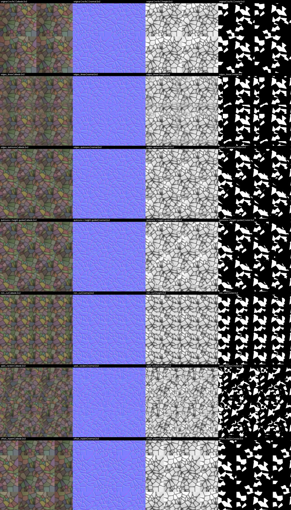
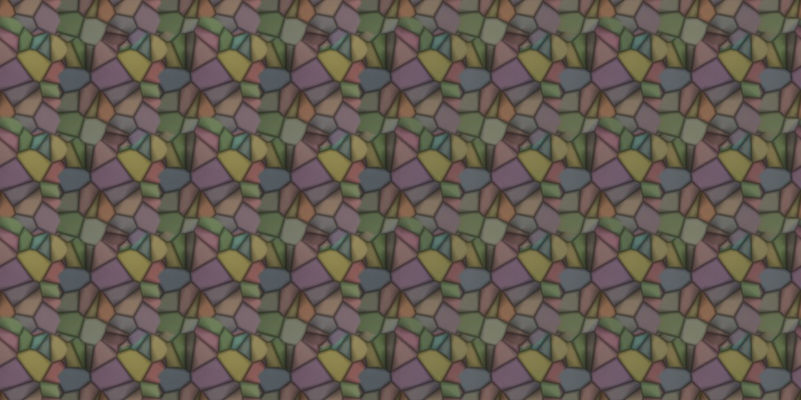
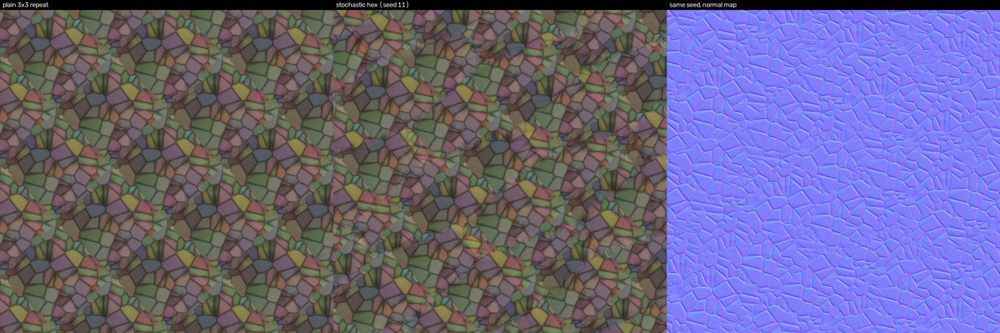
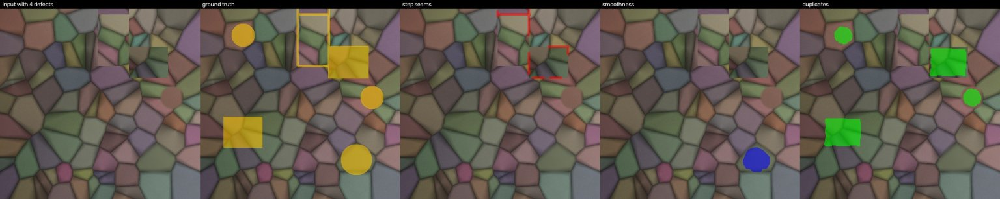
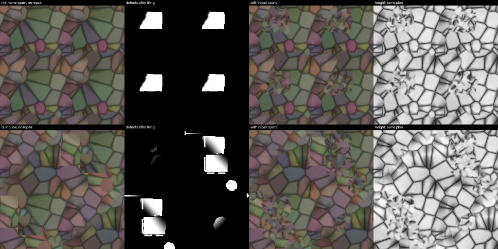
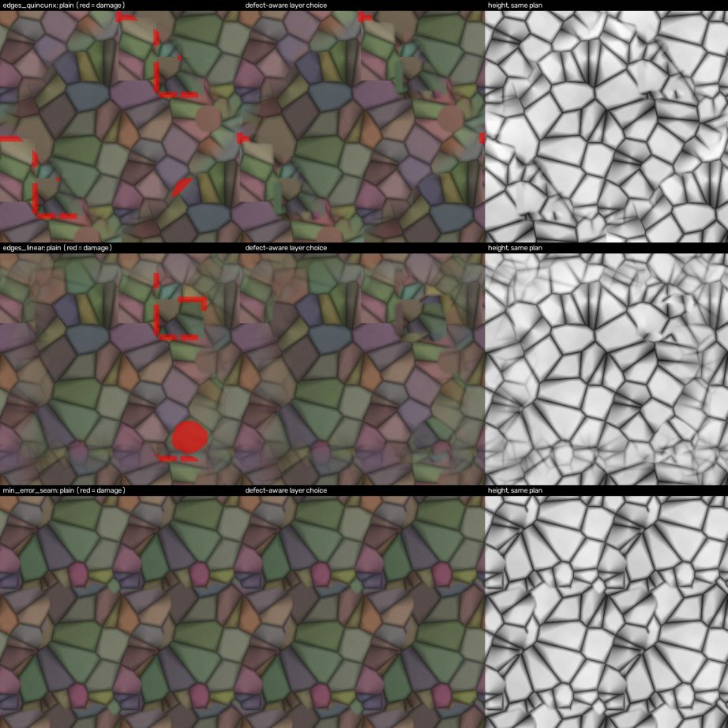
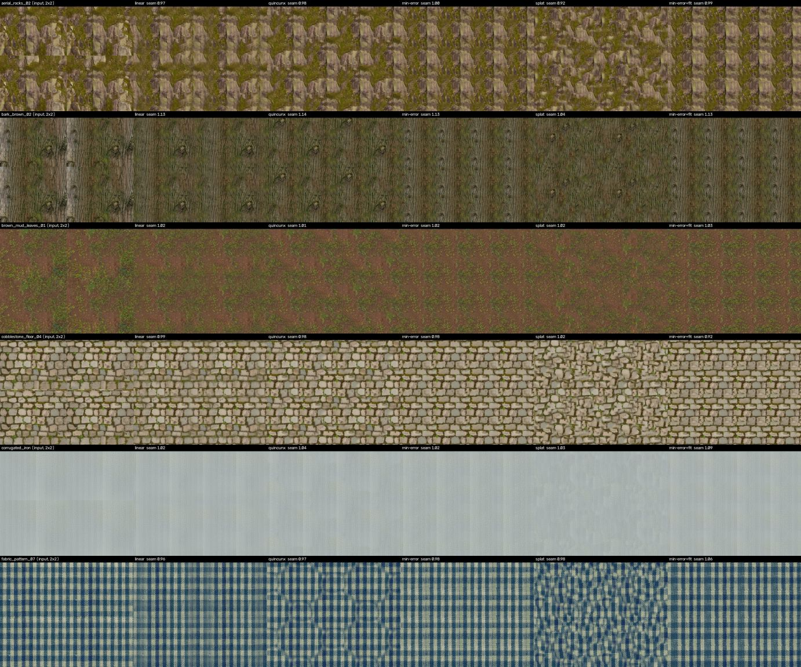
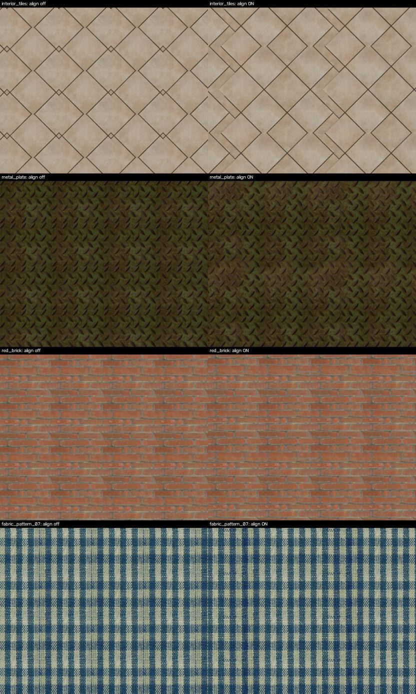

# Research: "Make Seamless / De-tile" node for chaiNNer

Goal: a node that turns a non-tiling photo/scan into a seamlessly tiling texture, using the
families of methods found in Substance Bitmap2Material (B2M), plus other techniques that are
feasible in chaiNNer. It should also be able to process a whole PBR stack (albedo, normal,
height, roughness, metal, AO, …) with **exactly the same** operation, so the maps stay aligned.

> **Status:** Node 1 (*Make Seamless*, §5) is implemented in
> `backend/src/nodes/impl/seamless.py` and
> `backend/src/packages/chaiNNer_standard/material_textures/tiling/make_seamless.py`, with tests in
> `backend/tests/test_seamless.py`. Offset + Inpaint was intentionally left out.

All findings below were checked with a working numpy/OpenCV prototype
([`prototype/detile.py`](prototype/detile.py), demo in [`prototype/demo.py`](prototype/demo.py)).

---

## 1. Two different problems hide behind "de-tile"

| Problem | Input | Output | Methods |
|---|---|---|---|
| **A. Make tileable** (B2M "Make It Tile") | a photo whose edges don't match | same-size image whose edges wrap seamlessly | Edges Linear, Edges Quincunx, min-error seam, Random/Splat, inpaint |
| **B. De-repeat** (stochastic texturing) | an *already tileable* texture | a larger bake (or the same size) in which the repetition isn't visible | hex-tiling / texture bombing with histogram-preserving blending |

**Recommendation:** ship **A** as the main node (it's what B2M does), and **B** as a second,
small node. Both use the same "plan once, apply to every map" design (§4).

---

## 2. What B2M does

From the B2M docs (Global Parameters → *Make It Tile*), there are 5 modes: **Edges Quincunx,
Edges Linear, Edges Linear X, Edges Linear Y, Random**. The older B2M 2 manual calls *Random*
"**Splat**" (with a "Splat Angle Random" control). The parameters are:

- **Tiling Transition Precision**: how sharp the blend between the original and the offset area is.
- Edges Quincunx: the mask is *"warped to adapt it to the image information"*.
- Edges Linear: uses a linear mask, which the docs say is *"more adapted for images that contain patterns"*.
- Random: *"a part of the image is splatted at different positions"*, with **Random Seed** and
  **Tiling Random Angle Variation**. Randomize gives new variations, and every one of them still tiles.
- B2M also runs a light equalizer before tiling (see §3.6, which turns out to be essential).

Related Substance Designer nodes: *Make It Tile Photo* (mask warping, mask size, mask precision
per axis), *Make It Tile Patch* (stamped round patches with size, disorder, size variation and
rotation variation), and *Smart Auto Tile*, which is like Make It Tile Photo but uses all channels.

---

## 3. Methods, how they work, prototype results

Test material: a synthetic 512² cobblestone stack (albedo, normal, height, roughness, and a
**half-resolution** binary metal map, to check that sync works across resolutions), with a
lighting gradient baked in. Each panel shows the result tiled 2×2.



Seam ratio = |jump across the wrap border| ÷ |average pixel-to-pixel difference|. A value of
**≈1 means seamless**; the original is 17.

| Method | albedo | normal | height | rough | metal | Notes |
|---|---|---|---|---|---|---|
| original (no fix) | 17.11 | 3.00 | 9.27 | 10.26 | 22.87 | |
| Edges Linear | 1.24 | 1.05 | 1.20 | 1.16 | 2.01 | ghosting (double exposure) in the bands |
| Edges Quincunx | 1.47 | 1.20 | 1.35 | 1.35 | 1.67 | smoother; small leaks at the 4 diamond tips |
| Quincunx + height-guided | 1.72 | 1.21 | 1.41 | 1.57 | 1.79 | crisp transitions that follow the stones |
| **Min-error seam** | **1.03** | 0.86 | **1.04** | 0.95 | 1.62 | best on structured content |
| **Splat Random** | 1.08 | 1.06 | 1.08 | 1.11 | **0.93** | best variety; can chop large features |
| Offset + inpaint | 1.62 | 1.42 | 1.54 | 1.52 | 2.51 | fails on low-frequency mismatch |

Speed at 2048² with numpy/OpenCV only:

| Method | plan (once) | apply (per map) |
|---|---|---|
| Edges Linear | 0.01 s | 0.22 s |
| Quincunx + height | 0.18 s | 0.09 s |
| Min-error seam | 0.70 s | 0.27 s |
| Splat Random (32) | 0.08 s | 1.57 s |
| Offset + inpaint | — | 0.71 s |
| Stochastic hex (2K out) | — | 1.4 s |

No Rust (`chainner_ext`) code is needed.

### 3.1 Edges Linear / Linear X / Linear Y
Two separable passes. Pass X computes `A = mx·I + (1−mx)·roll(I, w/2)`, where `mx` is 0 at the
left and right borders and 1 in the middle. At the border the result comes from the rolled copy,
whose pixels there are the original's continuous centre, so A tiles in X. Pass Y does the same on
A with `roll(A, h/2)`. Rolling preserves X-periodicity, so the result tiles in both axes.
Linear X and Linear Y simply skip one pass.

*Note:* a single 2-layer blend with a "cross" mask **cannot** work. The original's border seam
and the offset copy's centre seam meet at the 4 border midpoints, so you need either two passes
(Linear) or a diamond arrangement (Quincunx).

### 3.2 Edges Quincunx
One blend of the original with the `(w/2, h/2)`-offset copy, using a **diamond** mask
(`|dx|/cx + |dy|/cy < 1`). This is the 5-point quincunx lattice. The original's seams lie only
outside the diamond and the copy's seams (the centre cross) only inside it, so seams can leak
only at the 4 diamond tips. That is why B2M warps the mask: the prototype adds periodic value
noise to the mask's distance field, which must itself tile.

**Content-aware variant** ("adapt to the image information"): bias the mask by
`(guide_original − guide_offset)`, so that where the two layers overlap, the higher stone wins.
The transition then runs along mortar and cracks, as in a height blend. The bias is scaled by
`4m(1−m)` so that it **never touches m = 0 or m = 1**. My first version did not do this, and it
broke tiling (seam ratio 6.07); the seam metric caught it.

### 3.3 Min-error seam (image-quilting style)
Same two-pass structure as Linear, but each pass uses binary masks bounded by **minimum-cost
paths** (dynamic programming over `|A − B|²` of the guide) inside a band around x = w/4 and
x = 3w/4. The cuts snake through areas where both layers agree, which works well for stones,
bricks and tiles. Two details turned out to be required:
- The second pass's cut must be **cyclic** (first row = last row), or a seam reappears at the
  wrap. I solve this by running the DP twice, the second time with the start pinned to the end.
- Feather the mask with a **wrap-padded** blur, so the feathered mask is still periodic.

A graph cut (Kwatra et al. 2003) would be an improvement, but the DP version is already near 1.0.

### 3.4 Splat Random (B2M "Random" / "Splat")
Start from a tileable base (quincunx), then stamp N soft, noise-warped round patches. They are
copied from the source at random positions, optionally rotated, and pasted with **toroidal
wrap**, so a splat that crosses the border stays seamless. The first 4 splats are anchored on
the quincunx tips and border midpoints, which removes the quincunx leaks (seam ratio about 1.0).
Positions, sources, radii, angles and mask-noise seeds are all stored in **UV space**, so the
same splats replay on every map at any resolution. A new seed gives a new variation that still
tiles, matching B2M's "Randomize".

### 3.5 Offset + inpaint
Roll by half and inpaint the centre cross with OpenCV Telea. It is cheap, but it **cannot fix
low-frequency mismatches** (visible blocks in the contact sheet), and inpainting a normal map
needs renormalising. Keep it as a "simple" option at most. An AI-inpainting variant (LaMa etc.)
could live in the ONNX/PyTorch packages later.

### 3.6 Pre-pass: light equalization (important)
Every method only moves the problem: a baked lighting gradient turns into a periodic brightness
pattern (the banding in the min-cut albedo). Dividing out a heavy Gaussian blur (multiplicative
de-light, keeping the mean) removes it. Left: without it. Right: with it.



Apply it only to colour-like maps (albedo, AO), never to normals. It could be a checkbox on the
node or a separate *Equalize Lighting* node. chaiNNer's High Pass node is close, but it is
additive and centred on grey.

### 3.7 Contrast-preserving blending (Heitz & Neyret 2018)
A linear blend of two uncorrelated textures loses contrast by `sqrt(m² + (1−m)²)`, which gives
blurry, flat bands. The cheap fix (implemented in the prototype) is to rescale variance around
the mean: `(blend − μ) / sqrt(m² + (1−m)²) + μ`. The full histogram-preserving version
Gaussianises each channel with a 1-D lookup table and inverts it afterwards (Burley 2019's
simplification). That is easy in numpy (sort, then `scipy.special.ndtri`). It is best for
stochastic textures (sand, gravel, noise); it does nothing useful for normals or discrete maps.

### 3.8 Stochastic hex tiling (problem B)
For an already tileable map: a triangle grid in which every vertex gets a random UV offset. Each
output pixel blends 3 lookups with sharpened barycentric weights (Mikkelsen 2022), plus contrast
preservation. The same seed gives identical offsets for every map in the stack.



It breaks repetition well, but it **ghosts on structured content** (the stones). A later
improvement is to use the height-blend trick from §3.2 for the 3-way weights, which is what most
game engines now do for rocks.

---

## 4. Syncing a PBR stack

Split every method into **plan** and **apply**:

```
plan  = PLAN(guide, method, seed, params)   # computed once
out_i = APPLY(plan, map_i, kind_i)          # per map, at that map's resolution
```

- The plan holds masks at guide resolution, resized per map so that mixed 2K/4K stacks work.
  It also holds splats in UV. Aspect ratios must match (assert).
- **Guide**: height is the best choice (it drives content-aware seams and height blends); albedo
  luminance is the fallback. Everything random depends only on the seed and the image size.
- **Per-map handling** (`MapKind`):
  - *Color / scalar* (albedo, roughness, height, AO): plain or contrast-preserving blend;
    equalization is optional.
  - *Normal*: lerp, then **renormalise**. A rotated splat must also **rotate the XY vectors**
    by the same angle, and the sign depends on the **OpenGL vs. DirectX** green channel. A future
    mirror mode would have to flip X or Y. Alternative: tile the height map, then regenerate the
    normals with the existing *Normal Map Generator* node (it already has a **Tileable** option).
  - *Discrete* (metal masks, IDs, opacity): threshold the mask, so no in-between values are
    invented. In the test, the half-resolution metal map stayed perfectly aligned.

---

## 5. Proposed chaiNNer node design

### Node 1 (recommended first): **Make Seamless** — one image, syncable by wiring
Category `Material Textures` → new group **"Tiling"** (`material_textures/tiling/make_seamless.py`).

Inputs:
- `Image` (required)
- `Guide` (optional ImageInput). If it is not connected, the image's own luminance is used.
- `Map Type` (Enum): Color · Normal (OpenGL) · Normal (DirectX) · Mask/Discrete
- `Method` (Enum): Edges Linear · Edges Linear X · Edges Linear Y · Edges Quincunx · Min-Error
  Seam · Splat Random · Offset + Inpaint
- `seed_group(SeedInput())`
- `if_enum_group` per method:
  - transition width, mask warp, warp scale, height influence (Quincunx)
  - band width, feather (Min-Error Seam)
  - count, size, size variation, angle variation, softness, base method (Splat Random)
- `Equalize Lighting` (bool + radius), `Preserve Contrast` (bool)

Outputs: `ImageOutput(shape_as=0)` and an optional `Mask` output for debugging.

**Syncing a stack:** feed the **same Guide and Seed** into one *Make Seamless* per map. Every
plan is deterministic in (guide, seed, params), so the maps stay aligned. This works naturally
with chaiNNer iterators (Load Images over a folder of maps), and each node instance only
recomputes a cheap plan.

### Node 2: **Make Seamless (PBR Stack)**: one node, many maps
Same parameters, with fixed role slots, all optional (at least one must be connected):
Base Color, Normal, Height, Roughness, Metallic, AO, plus `optional_list_group` *Extra 1–4*
(color kind). Each output uses `image_type = match InputN { Image as i => i, null => never }`
(the pattern already used in `switch.py` and `image_dropdown_inputs.py`). Height is used as the
guide when it is connected. Metallic gets a "hard transitions" toggle. This is the B2M-like
experience in a single node.

### Node 3: **Stochastic Tiling** (problem B)
Inputs: tileable image, output size (or a repeats multiplier), cell scale, seed, map type,
preserve contrast. Syncing works the same way: the same seed on each instance.

### Implementation notes
- Code location: `backend/src/nodes/impl/seamless/` (plan/apply, masks, splats, normal helpers),
  with thin node wrappers. The prototype maps almost 1:1 onto this layout.
- Use `get_h_w_c`, float32 in [0, 1], and keep the alpha channel (blend it like a color channel).
- All periodic noise must itself be tileable (the prototype's `tileable_noise`).
- Tests: seam-ratio assertions (< 1.3 on random inputs) and "same plan gives identical masks
  across resolutions" checks belong in `backend/tests`.

### Open questions for you
1. Start with Node 1 (wire-to-sync) or Node 2 (single PBR node)? Node 1 is smaller and more
   chaiNNer-idiomatic; Node 2 is closer to B2M.
2. Should Offset + Inpaint ship at all, given how weak it is?
3. Is an AI-inpaint seam fixer (ONNX LaMa) worth a follow-up?

---

## 6. Detecting and avoiding internal defects (prototype)

Question: can the node find seams that are already *inside* a texture (sloppy cut and paste,
clone or heal brush) and keep them out of the result? Prototype: [`prototype/defects.py`](prototype/defects.py)
and [`prototype/defect_layer_choice.py`](prototype/defect_layer_choice.py).

### Detection cues
| Cue | Finds | How |
|---|---|---|
| 1-pixel step | hard paste edges, offset seams | The jump between two neighbouring pixels is far larger than the jumps 1–2 px away in the same direction. Optics spread natural photo edges over several pixels. Long straight runs are boosted. |
| Lost grain | heal / smudge / soft clone brush | Local fine-grain energy below about 45% of the image's typical level. |
| Copy-move | clone stamp, pasted patches (**both source and copy**) | Dense block matching on the high-pass image (Fridrich-style). Grain never repeats by chance, so many matching blocks with the same offset mean a copy. |

Test: the cobblestone material with photo-like grain and 4 injected defects. All 4 were found,
with **0% false alarms** on clean images and outside the defects. Detection takes 1.6 s at 512².



Robustness:
- JPEG quality 90 gives no false alarms. Quality 70 gives 1.9% false "lost grain" flags, and
  JPEG compression defeats copy-move detection.
- A blurry, grain-free source (upscaled or denoised) hides 1-pixel seams, though copy-move
  detection still works.
- 1-pixel-sharp CG/pixel-art edges would trigger the step cue (not tested).

### Using the mask
- **Repair splats (rejected):** covering defects with small round patches from clean areas
  turns structured content into confetti.
  
- **Defect-aware layer choice (works):** every method blends the image with a shifted copy of
  itself. Where one layer has a defect, prefer the other layer, except in the zones that
  guarantee tiling. The plan, and therefore the whole PBR stack, stays in sync. Leftover visible
  damage: Quincunx 2.45% → 0.35%, Linear 3.01% → 0%, Min-Error Seam 0% → 0% (its cuts already
  avoided the defects here). Seam scores were unchanged.
  
- **Limits:** a defect must be clean in the other layer, i.e. smaller than about a quarter of
  the image. If only a seam's *edge* is marked, it becomes a soft transition instead of
  vanishing. Duplicates are not damage and should only be treated as such on request.

---

## 7. Automatic choice and Pattern Align (implemented)

### Real textures (12 CC0 textures from Poly Haven, off-centre crops so they don't tile)
Min-Error Seam (with the two-band fix) was the best general method on real data too:
- Quincunx and Linear show the same feature twice per tile (a bark knot) and ghosted planks.
- Quincunx distorts the gingham checks; Splat breaks structured content.



So "Auto" has one real decision to make: **is it a repeating pattern, and in which axis?**

### Pattern Align = shift search + pattern fit
- **Shift:** the normalized self-correlation of the image detail, for shifts of 35–65% of the
  size. An axis counts as a pattern if it matches at least 0.2 better than at half the size.
- **Fit (needed):** the copy's content at the *left* cut comes from wrapping around the image
  edge, so it is offset by `size − shift`. Both cuts only line up if the shift **and** the size
  are whole numbers of repeats. A first version that aligned only the shift fixed one cut and
  left doubled grout lines on `interior_tiles`.
- **So:** estimate the repeat to sub-pixel accuracy (the smallest peak dividing the aligned
  shift whose multiples all match ≥ 80% as well; refined over all multiples), crop the centre to
  a whole number of repeats, resample back to the original size (at most 1.15× scaling,
  otherwise shift-only), then shift by a whole number of repeats. The shift is derived from the
  verified shift, so it is safe even if the repeat estimate were a fraction of the real one.
- **Rejected criterion: Min-Error cut cost.** On a panel grid, a half-size cut runs through
  flat panel interiors where both copies agree. The cut looked fine, but the result had
  wrong-width panels.

| Correlation gain over half size | |
|---|---|
| Patterns: tiles, metal plate, corrugated iron (X only), fabric, brick rows, synthetic panels, a real diamond-plate photo (Y) | 0.27 – 1.40 |
| Non-patterns: rocks, bark, mud, cobblestone, plaster, sand, real concrete photos, laminate | ≤ 0.12 |



(Left: Min-Error, half shift. Right: with Pattern Align.) Fabric: a hard seam through the
checks disappears. Metal plate: smoother. Brick/tiles: about equal. Laminate is correctly
left alone; an earlier, looser threshold aligned it on plank ends, so all ends lined up in one
column.

### Normal maps without a guide
They get a height guide reconstructed from their own normals (FFT Poisson integration, minus
large-scale drift). Red-brick test: the normal map alone reached the same Pattern Align
decision as the albedo with the real height map.

## 8. Lighting removal on real photos

Three phone photos (a tread plate with a strong reflective hotspot and two concrete floors).
Metric: leftover large-scale brightness variation.

| Photo | Original | Divide by blur (current) | + local contrast normalization |
|---|---|---|---|
| Tread plate | 0.42 | **0.05** | 0.08 |
| Concrete A | 0.07 | **0.01** | 0.02 |
| Concrete B | 0.12 | **0.02** | 0.03 |

- The current method (divide by a heavy blur) is the best of these. Contrast normalization
  amplified white specks into repeating blotches.
- A **specular hotspot** can't be fixed by any brightness/contrast correction. Inside it, the
  contrast is *inverted*: flat metal is bright and the raised diamonds are dark, the reverse of
  elsewhere. This needs diffuse light when shooting (overcast, or cross-polarized flash), or
  replacing the hotspot area with content from elsewhere.

## 9. Perspective correction (implemented: *Correct Perspective* node)

`backend/src/nodes/impl/perspective.py`, node in Material Textures → Tiling. Like Make Seamless,
the correction is planned once from a guide and applied to every map at its own resolution.

- **Four Corners (guided):** 4 points (as % of the image) that form a rectangle on the surface.
- **Automatic (Lines):** LSD segments, RANSAC vanishing points of the near-vertical and
  near-horizontal families; the line through both is sent to infinity, then both families are
  made axis-aligned (equal X/Y scale at the image centre). If one family is missing, it is
  left as is.
  - Tilted wall photo (2879×3860): 110 vertical and 74 horizontal segments, 0.4 s.
- **Automatic (Pattern):** searches the two perspective terms that maximize the self-match
  peaks of the detail.
  - Known tilts of a test grid are recovered (regularity ≥ 85% of the untilted grid).
  - **Align Pattern to Axes:** maps the near-horizontal and near-vertical repeats exactly onto
    the axes, removing rotation **and shear**. An angled shot leaves an affine shear that
    perspective terms can't see.
  - Real tread-plate photo: regularity 0.57 → 0.75, then 2.9° rotation and 2.8° shear
    removed. Make Seamless then fitted 19 whole repeats in both axes; before, it found none.
- **Normal maps:** vectors are rotated with the local rotation of the warp (verified against
  normals derived from a warped height map). Masks use nearest-neighbour sampling.
- **Impossible results** (horizon crossing the image, >4× enlargement) raise a clear error and
  suggest Four Corners.

Make Seamless also got **Axes: X and Y / X only / Y only** for Min-Error Seam (e.g. a wall that
only repeats horizontally), and full-resolution processing got about 9× faster (fast gaussian
approximation for wide blurs, max error 1e-4).

---

## Sources
- [B2M — Make your image tile](https://helpx.adobe.com/substance-3d-b2m/desktop/main-features/make-your-image-tile.html), [B2M parameters](https://helpx.adobe.com/substance-3d-b2m/desktop/parameters.html), [B2M3 Randomize](https://substance3d.adobe.com/documentation/b2m3/randomize-67797032.html), [Bitmap2Material 2 manual](https://usermanual.wiki/Pdf/bitmap2material2manual.1323014820/html)
- [Make It Tile Photo/Patch parameters (ArtStation)](https://badraztt.artstation.com/blog/q0v7/make-it-tile-substance-painter-filter), [Smart Auto Tile](https://helpx.adobe.com/substance-3d-designer/substance-compositing-graphs/nodes-reference-for-substance-compositing-graphs/node-library/material-filters/scan-processing/smart-auto-tile.html)
- Heitz & Neyret 2018, *High-Performance By-Example Noise using a Histogram-Preserving Blending Operator* ([HAL](https://hal.archives-ouvertes.fr/LJK/hal-01824773v1)); [Unity demo (Deliot, Heitz, Neyret)](https://unity-grenoble.github.io/website/demo/2020/10/16/demo-histogram-preserving-blend-synthesis.html)
- Burley 2019, *On Histogram-Preserving Blending for Randomized Texture Tiling* ([JCGT](https://www.jcgt.org/published/0008/04/02/paper.pdf))
- Mikkelsen 2022, *Practical Real-Time Hex-Tiling* ([JCGT](https://jcgt.org/published/0011/03/05/paper.pdf))
- Efros & Freeman 2001, *Image Quilting* ([PDF](https://www.cs.princeton.edu/courses/archive/fall14/cos526/papers/efros01.pdf)); Kwatra et al. 2003, *Graphcut Textures*
- [Material Maker Splatter node](https://rodzill4.github.io/material-maker/doc/node_transform_splatter.html)
