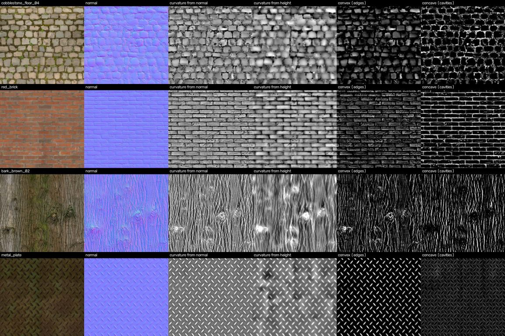

# Research: curvature maps and synthetic roughness for chaiNNer

Goal: generate a **curvature map** from a normal or height map, and a **synthetic roughness map**
from an albedo (plus optional curvature, AO, colour picks), with artist controls such as
average roughness and contrast. The work is aimed at photo-scanned textures that come without a
roughness map.

Prototype: [`prototype/`](prototype). The evaluation uses 41 CC0 material sets from Poly Haven
(albedo, normal, height, AO and their roughness map), fetched with
[`prototype/fetch_polyhaven.py`](prototype/fetch_polyhaven.py).

---

## 1. Quick answers

- **16-bit PNG: yes.** *Save Image* has *Color Depth: 16 Bits/Channel* for PNG (and TIFF), so a
  roughness map keeps smooth gradients for fine-tuning in a game engine. Roughness is linear data:
  import it as non-colour/linear in the engine. For Unity's smoothness, invert it.
- **Material preview: not built in, but feasible as a node.** chaiNNer has no 3D viewport, but a
  node can *render a preview image*: the material on a lit sphere, shown with *View Image*. The
  prototype's `render_sphere` (GGX specular, one key light plus sky ambient, tone mapping, about
  0.1 s at 256 px) is good enough to judge roughness by eye; see the previews below. It updates
  whenever the chain runs. Rotating it interactively is not possible.

---

## 2. Curvature

| | From normal map | From height map |
|---|---|---|
| Method | divergence of the normal field, summed over blur scales 1–16 px (like Substance's *Curvature Smooth*) | negative Laplacian of the height, same scales |
| Result | crisp, follows edges and cavities | blotchier: height maps carry large-scale undulation that leaks in |
| Agreement | correlation 0.75–0.89 between the two on 4 test materials | |

**Use the normal map.** It's what Substance's curvature nodes take, it carries the fine detail,
and it has no height scale to guess. A height-map option is still useful when there is no normal
map, or the height can be converted to a normal map first with chaiNNer's existing *Normal Map
Generator*.

Output convention (as in Substance): 0.5 = flat, brighter = convex (edges, ridges), darker =
concave (cavities, gaps). It's also useful to split it into **convex** and **concave** masks.

---

## 3. Roughness: what predicts it?

For each Poly Haven material, each cue was rank-correlated with Poly Haven's own roughness map.

| Cue | Mean correlation | Median abs. correlation | Materials with r > 0.1 / r < −0.1 |
|---|---|---|---|
| Albedo brightness | −0.57 | **0.97** | 6 / 32 |
| Deviation from local average brightness | −0.54 | 0.89 | 6 / 32 |
| Saturation | +0.30 | 0.50 | 27 / 7 |
| Occlusion (1 − AO) | +0.19 | 0.26 | 27 / 8 |
| Concave curvature | +0.13 | 0.11 | 20 / 5 |
| Convex curvature | −0.12 | 0.13 | 4 / 19 |
| Fine-detail energy | ~0 | 0.12 | 11 / 10 |

| Model (Pearson correlation with Poly Haven's roughness) | Mean |
|---|---|
| Brightness only, best direction per material | 0.79 |
| One fixed recipe (fitted on the other materials) | 0.55, **negative on 7 of 41** |
| All cues, tuned per material | **0.92** |

**What this means:**
1. **Poly Haven's roughness maps are mostly brightness remaps of the albedo.** They are also
   flat (average 0.73, typical spread only 0.03). They are artist-derived, not measured, so they
   are a good reference for a professional brightness remap but **cannot validate curvature or
   AO**: those barely correlate simply because Poly Haven didn't use them.
2. **The direction depends on the material.** "Darker = rougher" for 32 materials, the opposite
   for 6 (leather, plaster, roof tiles, …). No fixed recipe works: the node needs **Invert**, plus
   per-material **Average Roughness** and **Contrast**.
3. **Curvature and AO are artistic layers:** edge wear (convex → smoother or rougher), dirt in
   cavities and occluded areas (rougher). The metal plate shows it: Poly Haven's roughness
   emphasises the raised treads, which brightness can't produce but curvature can. On wood, the
   noisy normal map makes curvature over-roughen, so these layers must be opt-in, with a scale.
4. Physically, roughness can't be measured from one diffuse photo. A real measurement needs
   several lightings (e.g. flash / no-flash pairs) or a neural network trained for it (§5).

(Left to right: albedo, Poly Haven roughness, synthetic from brightness, plus cavity/AO rougher and
edges smoother, then sphere previews of the three.)

### Colour picks (secondary roughness)

[Materialize](https://github.com/BoundingBoxSoftware/Materialize) (GPL-3.0, like chaiNNer), a
popular photo-to-material tool, builds smoothness from **regions, not brightness**:
- a base value;
- up to two **sampled colours**, each matched in hue, saturation and lightness against a *blurred*
  albedo, with weights and a soft threshold, assigning its own value;
- a metal mask with its own value;
- contrast and bias;
- the albedo's fine detail (albedo minus its blur) multiplying the result.

The prototype does the same with a soft Lab-distance mask. On Poly Haven's green painted metal,
picking the rust colour isolates the rust spots and streaks (1.2% of the image at 12% tolerance),
which then become rougher than the paint. Poly Haven's own map is flat 0.50 there, so this is
purely an artistic choice, judged in the preview.

### A commercial photoscan set (UV atlas)

Checked against a licensed photoscan material: a wicker basket, as a 2048² UV atlas with
albedo, AO, bump, cavity, gloss, normal, roughness and specular maps. The set
can't be redistributed, so only numbers are given here. Statistics cover the texture islands
(70% of the atlas); the black background is excluded.

- **Roughness is computed from albedo brightness alone.** Rank correlation with albedo
  brightness is −0.998. A straight line in linear-light luminance reproduces it almost exactly:
  `roughness ≈ 0.938 − 0.514 × L_linear`, RMSE 0.003 (under one 8-bit level). The leftover error
  doesn't correlate with AO (−0.02) or cavity (−0.12), so no geometry went into it.
- **Gloss is exactly `1 − roughness`** (r = −1.00).
- **The range is narrow:** mean 0.84, standard deviation 0.04 (p1–p99: 0.74–0.91). That matches
  the Poly Haven finding that scanned roughness is a gentle, low-contrast remap of brightness.
- **Generate Roughness reproduces it** (r = 0.985) with *Brighter Is Rougher* off, global
  reference, and Average/Contrast set to 0.84/0.04. **But on an atlas the background matters:**
  - Mean and spread computed over the whole atlas, background included: RMSE 0.034, biased
    0.024 smoother.
  - Over the texture only: RMSE 0.007.

  So for atlases the node should compute its statistics only where there is texture (from the
  alpha channel, or an optional mask input).
- **Linear-light vs sRGB brightness:** linear fits this scan better (r 0.997 vs 0.985). On the 12
  Poly Haven materials the result is mixed: linear is better on 3 and worse on 5, with median
  |r| 0.929 vs 0.944. Keep sRGB as the default.
- **The specular map is derived from the cavity map, not from the albedo:**
  `specular ≈ 0.24 × cavity − 0.03` (r 0.975, RMSE 0.005). So in this set, roughness comes from
  colour and specular comes from geometry.
- **The normal map is OpenGL:**
  - The bump map's slopes agree with it (r +0.39 in x, +0.41 in y, Y up).
  - Curvature from the normal correlates +0.51 with the bump map when the normal is read as
    OpenGL, and about 0 when it is read as DirectX.
- **The Curvature Map node gives consistent results from either source.** At radius 1, curvature
  from the bump map and curvature from the normal map correlate +0.57. Both relate to the cavity
  map: +0.35 from the bump and +0.42 from the normal. The normal map carries more fine detail
  than the bump map, so it is the better source when both exist.

---

## 4. Proposed nodes

### Curvature Map (Material Textures → Normal Map)
- **Inputs:** Normal Map (OpenGL/DirectX), or a Height Map toggle; **Scale** (blur range, e.g.
  1–16 px); **Strength**.
- **Outputs:** Curvature (0.5 = flat), Convex mask, Concave mask.

### Generate Roughness (Material Textures)
- **Inputs:** Albedo (required); optional Curvature (or Normal Map, computed internally), AO and
  Metal mask.
- **Main controls:**
  - **Average Roughness** (the output's mean);
  - **Contrast** (its spread);
  - **Invert** ("brighter = rougher");
  - **Brightness Reference**: global average, or local average with a radius ("deviation from the
    average", which ignores large-scale lighting).
- **Layers**, each −100…+100 (negative = smoother):
  - **Edges** (convex);
  - **Cavities** (concave);
  - **Occlusion**;
  - **Fine Detail**.
- **Colour picks:** up to two, each a colour (chaiNNer's colour input) plus Roughness, Tolerance
  and Softness. A later step could pick the colour by clicking the albedo inside the node, reusing
  the image-in-node editor from the Correct Perspective branch.
- **Outputs:** Roughness (save as 16-bit PNG), optionally Smoothness (= 1 − roughness, for Unity).

### Material Preview (Material Textures)
- **Inputs:** Albedo, Normal, Roughness, Metal and AO (all optional except Albedo); **Light
  Angle**; **Shape** (sphere or flat tile); **Tiling**.
- **Output:** the rendered image, shown with View Image.

A 3D viewport is out of scope. This gives a quick look-dev check without leaving chaiNNer.

---

## 5. Further options

- **Neural networks for single-photo materials:**
  - Deschaintre et al. 2018: a single flash photo gives normal, diffuse, specular and roughness;
  - [SurfaceNet](https://github.com/perceivelab/surfacenet) (ICCV 2021, PyTorch code public);
  - Li et al. 2018, "Materials for Masses";
  - Luo et al. 2024 (Eurographics), learned gradient descent.

  chaiNNer runs PyTorch and ONNX models, so one of these could become a node, subject to its
  licence and weights. They are trained on flash-lit photos, so a capture guideline would come
  with it.
- **Flash / no-flash capture:** two photos from the same position; the difference isolates the
  specular reflection, from which real roughness can be estimated. More accurate than any albedo
  heuristic, but it needs a capture workflow.

---

## Sources
- Substance 3D Designer, [Curvature Smooth](https://helpx.adobe.com/substance-3d-designer/substance-compositing-graphs/nodes-reference-for-substance-compositing-graphs/node-library/filters/effects/curvature-smooth.html); Substance 3D Painter, [Curvature generator](https://experienceleague.adobe.com/en/docs/substance-3d-painter/using/effects/generators/curvature); [Polycount discussion](https://polycount.com/discussion/237570/have-anyone-figured-out-how-new-curvature-smooth-node-works-in-designer)
- [Materialize](https://github.com/BoundingBoxSoftware/Materialize) (Bounding Box Software, GPL-3.0); [CG Channel article](https://www.cgchannel.com/2018/10/free-tool-materialize-converts-photos-to-pbr-materials); [Valve Developer wiki](https://developer.valvesoftware.com/wiki/Materialize)
- [3DCoat: cavity and curvature maps](https://3dcoat.com/documentation/?p=10661); [procedural edge wear (Blender)](https://www.strayspark.studio/learn/tutorials/procedural-edge-wear-blender)
- Deschaintre et al. 2018 (see [Self-augmented CNNs](https://arxiv.org/pdf/1809.00886) for related work); [SurfaceNet](https://arxiv.org/pdf/2107.11298); [Materials for Masses](https://arxiv.org/pdf/1804.05790); [Luo et al. 2024](https://diglib7.eg.org/bitstream/handle/10.1111/cgf15018/v43i2_05_15018.pdf)
- [Poly Haven](https://polyhaven.com) textures (CC0)
