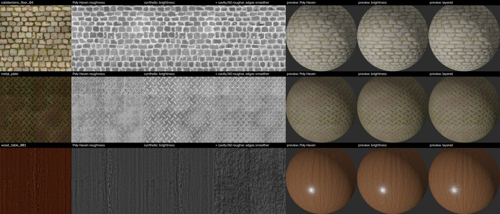
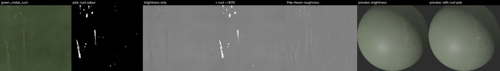

# Research: curvature maps and synthetic roughness for chaiNNer

Goal: generate a **curvature map** from a normal or height map, and a **synthetic roughness map**
from an albedo (plus optional curvature, AO, colour picks), with artist controls such as
average roughness and contrast. The work is aimed at photo-scanned textures that come without a
roughness map.

Prototype: [`prototype/`](prototype). The evaluation uses 41 CC0 material sets from Poly Haven
(albedo, normal, height, AO and their roughness map), fetched with
[`prototype/fetch_polyhaven.py`](prototype/fetch_polyhaven.py).

---

## 1. Quick answers

- **16-bit PNG: yes.** *Save Image* has *Color Depth: 16 Bits/Channel* for PNG (and TIFF), so a
  roughness map keeps smooth gradients for fine-tuning in a game engine. Roughness is linear data:
  import it as non-colour/linear in the engine. For Unity's smoothness, invert it.
- **Material preview: not built in, but feasible as a node.** chaiNNer has no 3D viewport, but a
  node can *render a preview image*: the material on a lit sphere, shown with *View Image*. The
  prototype's `render_sphere` (GGX specular, one key light plus sky ambient, tone mapping, about
  0.1 s at 256 px) is good enough to judge roughness by eye; see the previews below. It updates
  whenever the chain runs. Rotating it interactively is not possible.

---

## 2. Curvature

| | From normal map | From height map |
|---|---|---|
| Method | divergence of the normal field, summed over blur scales 1–16 px (like Substance's *Curvature Smooth*) | negative Laplacian of the height, same scales |
| Result | crisp, follows edges and cavities | blotchier: height maps carry large-scale undulation that leaks in |
| Agreement | correlation 0.75–0.89 between the two on 4 test materials | |

**Use the normal map.** It's what Substance's curvature nodes take, it carries the fine detail,
and it has no height scale to guess. A height-map option is still useful when there is no normal
map, or the height can be converted to a normal map first with chaiNNer's existing *Normal Map
Generator*.

Output convention (as in Substance): 0.5 = flat, brighter = convex (edges, ridges), darker =
concave (cavities, gaps). It's also useful to split it into **convex** and **concave** masks.

---

## 3. Roughness: what predicts it?

For each Poly Haven material, each cue was rank-correlated with Poly Haven's own roughness map.

| Cue | Mean correlation | Median abs. correlation | Materials with r > 0.1 / r < −0.1 |
|---|---|---|---|
| Albedo brightness | −0.57 | **0.97** | 6 / 32 |
| Deviation from local average brightness | −0.54 | 0.89 | 6 / 32 |
| Saturation | +0.30 | 0.50 | 27 / 7 |
| Occlusion (1 − AO) | +0.19 | 0.26 | 27 / 8 |
| Concave curvature | +0.13 | 0.11 | 20 / 5 |
| Convex curvature | −0.12 | 0.13 | 4 / 19 |
| Fine-detail energy | ~0 | 0.12 | 11 / 10 |

| Model (Pearson correlation with Poly Haven's roughness) | Mean |
|---|---|
| Brightness only, best direction per material | 0.79 |
| One fixed recipe (fitted on the other materials) | 0.55, **negative on 7 of 41** |
| All cues, tuned per material | **0.92** |

**What this means:**
1. **Poly Haven's roughness maps are mostly brightness remaps of the albedo.** They are also
   flat (average 0.73, typical spread only 0.03). They are artist-derived, not measured, so they
   are a good reference for a professional brightness remap but **cannot validate curvature or
   AO**: those barely correlate simply because Poly Haven didn't use them.
2. **The direction depends on the material.** "Darker = rougher" for 32 materials, the opposite
   for 6 (leather, plaster, roof tiles, …). No fixed recipe works: the node needs **Invert**, plus
   per-material **Average Roughness** and **Contrast**.
3. **Curvature and AO are artistic layers:** edge wear (convex → smoother or rougher), dirt in
   cavities and occluded areas (rougher). The metal plate shows it: Poly Haven's roughness
   emphasises the raised treads, which brightness can't produce but curvature can. On wood, the
   noisy normal map makes curvature over-roughen, so these layers must be opt-in, with a scale.
4. Physically, roughness can't be measured from one diffuse photo. A real measurement needs
   several lightings (e.g. flash / no-flash pairs) or a neural network trained for it (§5).

(Left to right: albedo, Poly Haven roughness, synthetic from brightness, plus cavity/AO rougher and
edges smoother, then sphere previews of the three.)

### Colour picks (secondary roughness)

[Materialize](https://github.com/BoundingBoxSoftware/Materialize) (GPL-3.0, like chaiNNer), a
popular photo-to-material tool, builds smoothness from **regions, not brightness**:
- a base value;
- up to two **sampled colours**, each matched in hue, saturation and lightness against a *blurred*
  albedo, with weights and a soft threshold, assigning its own value;
- a metal mask with its own value;
- contrast and bias;
- the albedo's fine detail (albedo minus its blur) multiplying the result.

The prototype does the same with a soft Lab-distance mask. On Poly Haven's green painted metal,
picking the rust colour isolates the rust spots and streaks (1.2% of the image at 12% tolerance),
which then become rougher than the paint. Poly Haven's own map is flat 0.50 there, so this is
purely an artistic choice, judged in the preview.

### A commercial photoscan set (UV atlas)

Checked against a licensed photoscan material: a wicker basket, as a 2048² UV atlas with
albedo, AO, bump, cavity, gloss, normal, roughness and specular maps. The set
can't be redistributed, so only numbers are given here. Statistics cover the texture islands
(70% of the atlas); the black background is excluded.

- **Roughness is computed from albedo brightness alone.** Rank correlation with albedo
  brightness is −0.998. A straight line in linear-light luminance reproduces it almost exactly:
  `roughness ≈ 0.938 − 0.514 × L_linear`, RMSE 0.003 (under one 8-bit level). The leftover error
  doesn't correlate with AO (−0.02) or cavity (−0.12), so no geometry went into it.
- **Gloss is exactly `1 − roughness`** (r = −1.00).
- **The range is narrow:** mean 0.84, standard deviation 0.04 (p1–p99: 0.74–0.91). That matches
  the Poly Haven finding that scanned roughness is a gentle, low-contrast remap of brightness.
- **Generate Roughness reproduces it** (r = 0.985) with *Brighter Is Rougher* off, global
  reference, and Average/Contrast set to 0.84/0.04. **But on an atlas the background matters:**
  - Mean and spread computed over the whole atlas, background included: RMSE 0.034, biased
    0.024 smoother.
  - Over the texture only: RMSE 0.007.

  So for atlases the node should compute its statistics only where there is texture (from the
  alpha channel, or an optional mask input).
- **Linear-light vs sRGB brightness:** linear fits this scan better (r 0.997 vs 0.985). On the 12
  Poly Haven materials the result is mixed: linear is better on 3 and worse on 5, with median
  |r| 0.929 vs 0.944. Keep sRGB as the default.
- **The specular map is derived from the cavity map, not from the albedo:**
  `specular ≈ 0.24 × cavity − 0.03` (r 0.975, RMSE 0.005). So in this set, roughness comes from
  colour and specular comes from geometry.
- **The normal map is OpenGL:**
  - The bump map's slopes agree with it (r +0.39 in x, +0.41 in y, Y up).
  - Curvature from the normal correlates +0.51 with the bump map when the normal is read as
    OpenGL, and about 0 when it is read as DirectX.
- **The Curvature Map node gives consistent results from either source.** At radius 1, curvature
  from the bump map and curvature from the normal map correlate +0.57. Both relate to the cavity
  map: +0.35 from the bump and +0.42 from the normal. The normal map carries more fine detail
  than the bump map, so it is the better source when both exist.

### Three commercial scanned materials

Three more licensed scans, each with albedo, roughness, AO, cavity, bump and displacement, and
two with a normal map:
- **green painted plaster** with flaking paint;
- **brick under patchy plaster**;
- **red conglomerate rock**.

The scans can't be redistributed, so only numbers are given here. Unlike the basket, none of
these roughness maps is just a brightness remap.

How much of the roughness each kind of information can explain (R² of a quadratic fit, 60,000
pixels per material):

| Material | Any brightness curve | All colour features | Geometry (AO, cavity, height, curvature) | Colour + geometry |
|---|---|---|---|---|
| Painted plaster | 0.27 | 0.33 | 0.88 | 0.97 |
| Brick and plaster | 0.15 | 0.54 | 0.58 | 0.83 |
| Conglomerate | 0.69 | 0.82 | 0.09 | 0.83 |

- **Painted plaster:**
  - Roughness follows the AO map almost exactly (r −0.93): the occluded areas where the paint
    has flaked off are rougher.
  - Brightness barely matters (r −0.34).
  - It's not possible to tell from the data whether the vendor derived roughness from AO, or the
    recessed bare plaster really is rougher.
- **Brick and plaster:**
  - Brightness doesn't predict roughness at all (r +0.07).
  - Colour does: the saturated red brick is smoother than the grey plaster (chroma r −0.57). So
    does AO (r −0.74).
- **Conglomerate:** brightness is the main cue (brighter is smoother, r −0.83). Geometry adds
  almost nothing.
- **Normal maps:** both normal maps follow the OpenGL convention. Curvature from the normal map
  matches curvature from the displacement only when the normal is read as OpenGL.

**What Generate Roughness can reach** (least-squares fit of its own controls):

| Material | Brightness only | + Edges / Cavities | + Occlusion | + one colour pick |
|---|---|---|---|---|
| Painted plaster | R² 0.11 | 0.34 | **0.92** (RMSE 0.006) | – |
| Brick and plaster | 0.01 | 0.19 | 0.64 | **0.77** (brick −0.02 smoother) |
| Conglomerate | **0.68** (RMSE 0.011) | 0.69 | 0.71 | – |

- **Global brightness beat local brightness on all three** (by 0.01–0.08 R²), so global stays
  the default.
- **The Occlusion layer is the strongest geometric cue.** Edges and Cavities add little once
  Occlusion is used.
- **Colour picks help when the material regions differ in hue rather than brightness.** The
  brick pick (tolerance 12) covers 31% of the image.
- **Scanned roughness has low contrast.** The standard deviation is 0.02 for these three, 0.04 for
  the basket, 0.075 and 0.11 for the two metal sheets below, and a median of 0.047 across the 12
  Poly Haven materials (0.015–0.14). The node's default Contrast of 10% is about twice the typical
  value; **5% is a better default.**

### Two scanned corrugated metal sheets

Two more licensed scans from the same vendor: weathered grey sheet and rusty sheet, scanned
with the vendor's own scanner, colour-calibrated against a chart, 2 × 2 m. Each comes with
albedo, roughness, gloss, specular, AO, cavity, bump, displacement and normal maps.

- **No metal information.** There is no metalness map, and the specular map is flat at about
  0.19 (sRGB) everywhere, about F0 0.03–0.04, the value for non-metals. So the vendor treats
  weathered and rusty metal as non-metallic throughout.
- **Gloss isn't exactly 1 − roughness.** The two are tightly linked (r −0.99), but differ by up
  to 0.15, and the curve between them differs between the two sheets.
- **The brightness direction is opposite in the two sheets:**

| Sheet | Roughness mean / sd | Brightness | Best Generate Roughness setup | R² |
|---|---|---|---|---|
| Weathered grey | 0.73 / 0.075 | brighter = **rougher** (r +0.84) | brightness only, *Brighter Is Rougher* on | 0.70 |
| Rusty | 0.77 / 0.11 (smoothest areas ≈ 0.3) | brighter = **smoother** (rank −0.87) | brightness + a colour pick on the rust (+0.16) | 0.60 |

  - All colour features together reach R² 0.86 and 0.72. Geometry adds almost nothing for
    either sheet (+0.00 / +0.01). Edges, Cavities and Occlusion barely help.
  - Global brightness beats local here too.

**Across all six commercial scans:**
- **The direction depends on the material.** Brighter is rougher on the basket and the weathered
  sheet, and brighter is smoother on the conglomerate, rusty sheet and painted plaster. There's no
  universal default, so *Brighter Is Rougher* has to stay a user choice.
- **The best cue also depends on the material:** brightness (basket, conglomerate, both metal
  sheets), occlusion (painted plaster) or colour (brick, rust). This supports keeping all three
  tools in the node: brightness, AO layer and colour picks.

### Twenty scanned materials

14 more licensed scans from the same vendor, analysed together with the 6 above (20 in total).
All were captured with the vendor's scanners, colour-calibrated against a chart, over areas of
0.4–2 m, and analysed at 1024². Two extra "imperfection" packs (scratch and smudge overlays with
no albedo) were left out.

R² of roughness explained by each source (1 = fully explained):
- **Upper bound:** a quadratic fit on colour and geometry (AO, cavity, displacement, curvature).
- **Node:** least-squares fits of the node's own controls (brightness, Edges/Cavities/Occlusion
  layers, one colour pick).

| Material | Mean | SD | Brightness rank-r | Colour | Geometry | Both | Node: brightness | + layers | + pick |
|---|---|---|---|---|---|---|---|---|---|
| Wood parquet | 0.72 | 0.013 | −0.56 | 0.35 | 0.72 | 0.83 | 0.33 | 0.67 | 0.67 |
| Black marble tiles | 0.54 | 0.035 | +0.56 | 0.39 | 0.39 | 0.67 | 0.20 | 0.43 | 0.44 |
| Brick facade | 0.73 | 0.004 | −0.87 | 0.81 | 0.62 | 0.84 | 0.80 | 0.84 | 0.84 |
| Brick and plaster | 0.92 | 0.019 | +0.20 | 0.57 | 0.59 | 0.85 | 0.01 | 0.67 | 0.78 |
| Bricks and mud | 0.82 | 0.032 | +0.19 | 0.05 | 0.14 | 0.22 | 0.03 | 0.08 | 0.09 |
| Conglomerate | 0.82 | 0.018 | −0.79 | 0.85 | 0.09 | 0.86 | 0.69 | 0.73 | 0.77 |
| Weathered metal sheet | 0.73 | 0.072 | +0.89 | 0.90 | 0.35 | 0.91 | 0.74 | 0.75 | 0.75 |
| Rusty metal sheet A | 0.77 | 0.105 | −0.90 | 0.78 | 0.09 | 0.78 | 0.54 | 0.54 | 0.60 |
| Dirty sidewalk tiles | 0.80 | 0.046 | +0.34 | 0.37 | 0.15 | 0.46 | 0.09 | 0.13 | 0.13 |
| Painted metal panel | 0.90 | 0.062 | −0.48 | 0.78 | 0.19 | 0.79 | 0.62 | 0.63 | 0.74 |
| Painted ceramic tiles | 0.51 | 0.085 | −0.19 | 0.96 | 0.23 | 0.96 | 0.05 | 0.27 | 0.44 |
| Painted plaster | 0.35 | 0.019 | −0.27 | 0.37 | 0.89 | 0.98 | 0.09 | 0.92 | 0.92 |
| Precast concrete | 0.64 | 0.074 | +0.66 | 0.91 | 0.71 | 0.92 | 0.79 | 0.81 | 0.82 |
| Rusty metal sheet B | 0.81 | 0.102 | −0.77 | 0.59 | 0.02 | 0.61 | 0.40 | 0.41 | 0.42 |
| Glossy worn tiles | 0.30 | 0.205 | −0.49 | 0.95 | 0.66 | 0.96 | 0.81 | 0.84 | 0.91 |
| Tactile paving | 0.88 | 0.023 | +0.41 | 0.37 | 0.16 | 0.59 | 0.22 | 0.41 | 0.42 |
| Stained red tiles | 0.74 | 0.044 | +0.09 | 0.51 | 0.33 | 0.60 | 0.01 | 0.34 | 0.45 |
| Terracotta tiles | 0.77 | 0.036 | +0.24 | 0.39 | 0.38 | 0.60 | 0.05 | 0.17 | 0.17 |
| Floor tiles | 0.86 | 0.021 | +0.85 | 0.82 | 0.17 | 0.83 | 0.74 | 0.76 | 0.78 |
| Wooden decking | 0.65 | 0.090 | −0.94 | 0.94 | 0.30 | 0.94 | 0.87 | 0.89 | 0.90 |
| **Median** | | **0.040** | | | | **0.83** | **0.37** | **0.65** | **0.70** |

**Findings:**
- **These roughness maps carry real information.** For 13 of 20 the best brightness curve
  explains less than half, and for five (mud, dirty sidewalk, terracotta, tactile paving,
  marble) colour and geometry together explain at most 0.67. No generator can recover what
  isn't in the albedo or the geometry.
- **Brightness direction:**
  - Strongly brighter = rougher on 4 materials, strongly brighter = smoother on 6, weak on 10.
  - The node's default (*Brighter Is Rougher* off) matches the majority. It has to stay a choice.
- **Colour is a stronger cue than geometry** on 16 of 20. Geometry wins on the wood parquet,
  painted plaster, glazed tiles with grout and the brick and plaster.
- **The node's own controls reach a median of 0.70,** against 0.37 for brightness alone and 0.83
  for the upper bound:
  - **Layers** (mostly Occlusion) add the most: median +0.28.
  - **One colour pick** adds up to +0.36 (the glossy tiles).
  - **A second pick** adds up to +0.07 more (painted ceramic 0.47 → 0.54, stained red tiles 0.33 →
    0.40, rusty sheet 0.63 → 0.68).
- **Global brightness is as good as local or better on 17 of 20.**
- **Contrast:** median SD 0.040 (quartiles 0.021–0.077, range 0.004–0.205). **Default: 4%.**
- **The metal mask helps where metal is present.** On the precast concrete (7.6% metal), the metal
  parts are smoother (0.43 vs 0.66). Every other set treats metal as non-metallic, with a flat
  specular of about 0.19, and gloss within 0.02–0.06 of 1 − roughness.
- **Tested and rejected: "colour axis" controls.**
  - A free mix of R, G and B could beat brightness a lot on a few materials. The painted ceramic
    goes 0.06 → 0.94, though the median change is small.
  - Users can't tune three weights. A two-click version (one smooth spot, one rough spot) only
    beat brightness by more than 0.05 on 4 of 20, and did worse than the two colour picks. Not
    worth adding.

### Albedo as height for normal maps

The same scans, 15–16 of which have a real displacement map, were used to test ways of turning
an image into height for *Normal Map Generator*.

**Metric:** the slope agreement between the image-derived height and the real displacement,
per detail size (+1 = same slopes, −1 = same but upside-down; 1024² for the first two tests,
512² for the lit photos).

**Delit albedo:**
- **Brightness is a weak stand-in for height:** median |agreement| about 0.2 for fine detail
  and about 0.1 for medium and large shapes.
- **It works only where colour and shape coincide,** such as dark grout or mortar in recesses,
  or gaps between planks: glazed tiles with grout 0.74–0.88, brick facade 0.62–0.77, wooden
  decking about 0.6.
- **The channel matters for red brick:** Red or Max RGB beats Average RGB (0.77 vs 0.62). Blue
  inverts it.
- **The direction is material-dependent:** dark is raised on 5 of 16 materials.
- **Large shapes are unreliable** on 11 of 16, and sometimes upside-down: they're mostly stains.
  High-pass before generating normals.
- **Edge-preserving smoothing helps wood** (decking fine detail 0.63 → 0.75).
- **No universal grey conversion exists:** the best per-material RGB mix reaches only about
  0.2–0.4, with different weights for every material.

**Colour pick on the recess colour** (soft mask as height):
- Better than brightness on brick and tile layouts: brick facade 0.73 → 0.80, brick and plaster
  0.35 → 0.46.
- Most other materials have no distinct recess colour.

**Synthetic lit photos** (each albedo relit with a directional light from its own normal map,
35° elevation, three directions, plus a ±30% brightness falloff):
- **Height from directional shading** (B2M-style "light" mode: integrate the high-passed log
  luminance along the light direction) with the **true light direction** gives a median of
  +0.29 (medium detail), against +0.07 for brightness.
  - Strong on materials with real relief: brick facade 0.81, painted plaster 0.78, brick and mud
    0.76, corrugated metal 0.61–0.76, brick and plaster 0.63.
  - Worse than brightness where colour, not relief, dominates: glossy tiles 0.19 vs 0.81,
    decking 0.23 vs 0.51.
- **Automatic light direction is unreliable.** The method assumes that the shading's spectrum
  has a cos² lobe along the light, so it measures the image's spectral orientation.
  - Median axis error was 29°, and only 22% were within 15°.
  - It locks onto the texture's own orientation (corrugation, planks, brick rows), and works
    only on isotropic relief (mud 2–8°, painted plaster 3–19°).
  - The convex/concave sign can't be told apart: a "dark = low" prior was right 44% of the
    time. With the auto direction, agreement drops to about 0.
- **The light direction should be set by the user** (an angle, checked in Material Preview),
  as B2M does.
- **Brightness falloff is easy to remove automatically:** dividing by a heavy blur (flat field)
  cut the falloff's correlation from 0.97 to 0.15.
- Real photos add specular highlights, cast shadows and non-directional light, so expect lower
  numbers than these synthetic ones.

**Refining a manual light direction automatically.**

Starting from a deliberately wrong guess, three refinements searched within ±45° of it in 5°
steps (90 cases per guess error):
- **Least-energy shape:** pick the angle whose height has the least slope energy (a wrong
  direction invents streaks).
- **Re-render check:** rebuild the height at each angle, relight it with a Lambertian model
  (clipped self-shadowing, a few height scales and light elevations), and pick the angle that
  best reproduces the flat-fielded photo.
- **Combined:** both scores, normalised and added.

| Guess off by | Method | Median angle error | Within 10° | Improved / worse than the guess | Height agreement (true direction: 0.29) |
|---|---|---|---|---|---|
| 20° | (guess) | 20° | 0% | – | 0.21 |
| 20° | least energy | 25° | 16% | 22% / 52% | 0.12 |
| 20° | **re-render** | 17.5° | 47% | 50% / 36% | **0.28** |
| 35° | (guess) | 35° | 0% | – | 0.11 |
| 35° | least energy | 30° | 24% | 72% / 28% | 0.13 |
| 35° | **re-render** | **10°** | **62%** | 74% / 26% | **0.23** |

- **The re-render check works; the least-energy prior doesn't.**
- **It's most useful for rough guesses.** Height quality is forgiving within about 20°, so a
  close guess barely changes the result.
- **It's reliable on relief without a grain:** from 35° off, bricks, plaster and mud land within
  0–10° and recover the true-direction agreement.
- **It fails on strongly directional textures** (corrugated metal, precast concrete). The search
  slides toward the texture's own axis and stops at the edge of the window.
- **So:** make refinement optional, limit the search to about ±30°, and show the refined angle
  so the user can accept or reset it.
- **Side results:** the search also estimates the light's height and the shape's depth, which
  could suggest a normal-map strength.
- **Cost:** about 17 s per photo in this unoptimised test. A coarse-to-fine search on a reduced
  copy would take a few seconds.

**Real photos** (10 phone photos: low sun on a rubber mat, grass, asphalt, concrete and weeds,
plus a shiny indoor floor and a panelled wall; not included):
- **The search can't tell a direction from its 180° flip.** Both get identical scores.
- **On grass and weeds the score barely changes with angle** (range 6–7%), so there's no usable
  direction signal.
- **On textures with a grain, it locks onto the pattern** (rubber mat, broom-finished concrete,
  wall panels).
- **The integrated height is dominated by large-scale errors.** Stains and colour patches become
  bulges, a concrete joint becomes a step between slabs, and specular hotspots on the shiny floor
  become hills.
- **Plain brightness height** (after removing falloff) looked better on every photo: crisp
  grain, the joint as a groove, and the mat's bars raised.
- **Conclusion:** the synthetic test (Lambertian, no specular, no stains) overstated the
  directional-light method. Don't build it as a general tool. If revisited, it would need
  highlight removal and a strong high-pass first, and should only be used for fine detail.

---

## 4. Proposed nodes

### Curvature Map (Material Textures → Normal Map)
- **Inputs:** Normal Map (OpenGL/DirectX), or a Height Map toggle; **Scale** (blur range, e.g.
  1–16 px); **Strength**.
- **Outputs:** Curvature (0.5 = flat), Convex mask, Concave mask.

### Generate Roughness (Material Textures)
- **Inputs:** Albedo (required); optional Curvature (or Normal Map, computed internally), AO and
  Metal mask.
- **Main controls:**
  - **Average Roughness** (the output's mean);
  - **Contrast** (its spread);
  - **Invert** ("brighter = rougher");
  - **Brightness Reference**: global average, or local average with a radius ("deviation from the
    average", which ignores large-scale lighting).
- **Layers**, each −100…+100 (negative = smoother):
  - **Edges** (convex);
  - **Cavities** (concave);
  - **Occlusion**;
  - **Fine Detail**.
- **Colour picks:** up to two, each a colour (chaiNNer's colour input) plus Roughness, Tolerance
  and Softness. A later step could pick the colour by clicking the albedo inside the node, reusing
  the image-in-node editor from the Correct Perspective branch.
- **Outputs:** Roughness (save as 16-bit PNG), optionally Smoothness (= 1 − roughness, for Unity).

### Material Preview (Material Textures)
- **Inputs:** Albedo, Normal, Roughness, Metal and AO (all optional except Albedo); **Light
  Angle**; **Shape** (sphere or flat tile); **Tiling**.
- **Output:** the rendered image, shown with View Image.

A 3D viewport is out of scope. This gives a quick look-dev check without leaving chaiNNer.

---

## 5. Further options

- **Neural networks for single-photo materials:**
  - Deschaintre et al. 2018: a single flash photo gives normal, diffuse, specular and roughness;
  - [SurfaceNet](https://github.com/perceivelab/surfacenet) (ICCV 2021, PyTorch code public);
  - Li et al. 2018, "Materials for Masses";
  - Luo et al. 2024 (Eurographics), learned gradient descent.

  chaiNNer runs PyTorch and ONNX models, so one of these could become a node, subject to its
  licence and weights. They are trained on flash-lit photos, so a capture guideline would come
  with it.
- **Flash / no-flash capture:** two photos from the same position; the difference isolates the
  specular reflection, from which real roughness can be estimated. More accurate than any albedo
  heuristic, but it needs a capture workflow.

---

## Sources
- Substance 3D Designer, [Curvature Smooth](https://helpx.adobe.com/substance-3d-designer/substance-compositing-graphs/nodes-reference-for-substance-compositing-graphs/node-library/filters/effects/curvature-smooth.html); Substance 3D Painter, [Curvature generator](https://experienceleague.adobe.com/en/docs/substance-3d-painter/using/effects/generators/curvature); [Polycount discussion](https://polycount.com/discussion/237570/have-anyone-figured-out-how-new-curvature-smooth-node-works-in-designer)
- [Materialize](https://github.com/BoundingBoxSoftware/Materialize) (Bounding Box Software, GPL-3.0); [CG Channel article](https://www.cgchannel.com/2018/10/free-tool-materialize-converts-photos-to-pbr-materials); [Valve Developer wiki](https://developer.valvesoftware.com/wiki/Materialize)
- [3DCoat: cavity and curvature maps](https://3dcoat.com/documentation/?p=10661); [procedural edge wear (Blender)](https://www.strayspark.studio/learn/tutorials/procedural-edge-wear-blender)
- Deschaintre et al. 2018 (see [Self-augmented CNNs](https://arxiv.org/pdf/1809.00886) for related work); [SurfaceNet](https://arxiv.org/pdf/2107.11298); [Materials for Masses](https://arxiv.org/pdf/1804.05790); [Luo et al. 2024](https://diglib7.eg.org/bitstream/handle/10.1111/cgf15018/v43i2_05_15018.pdf)
- [Poly Haven](https://polyhaven.com) textures (CC0)
